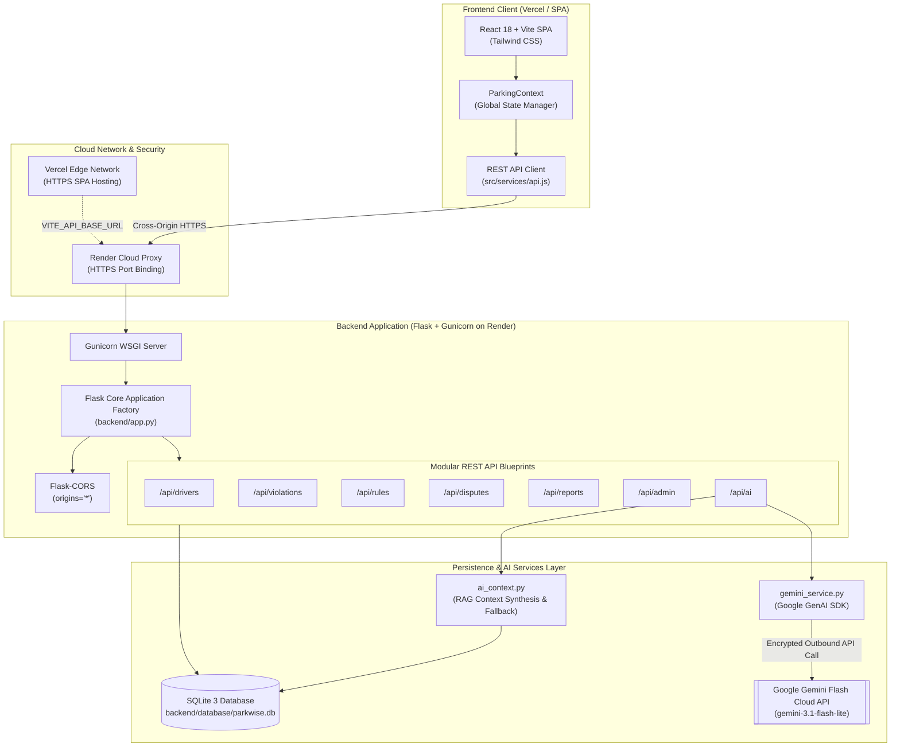
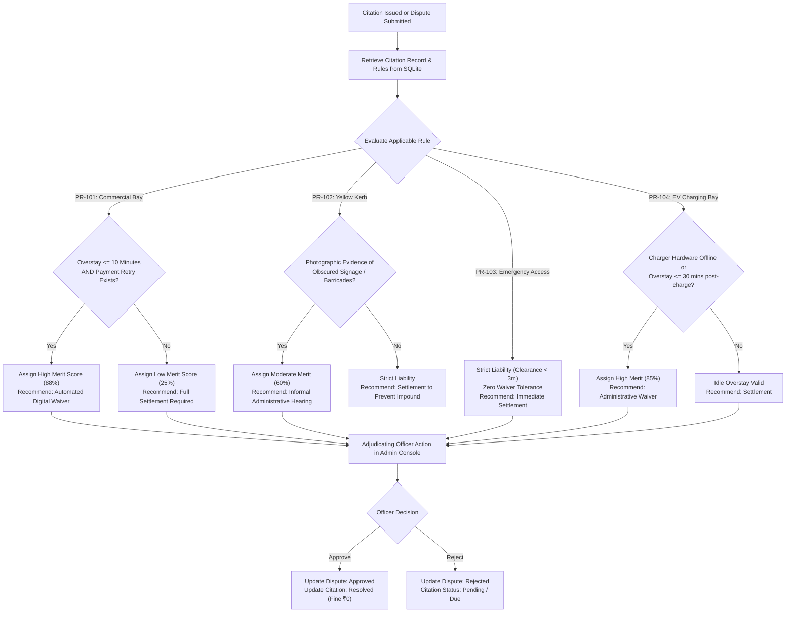
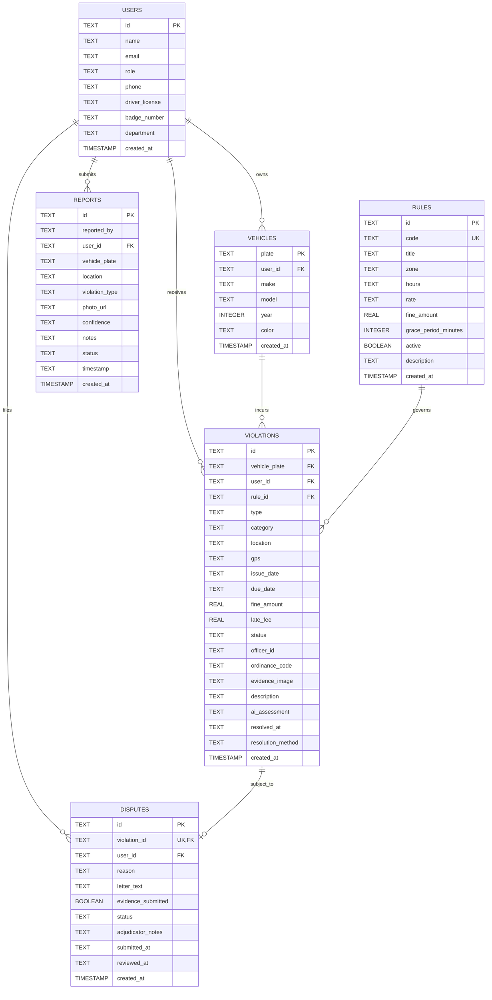

# ParkWise AI — AI-Based Smart Parking Violation Assistant

> **An Explainable AI (XAI) & Retrieval-Augmented Generation (RAG) Municipal Parking Compliance, Citation Adjudication, and Citizen Incident Reporting Platform.**

[](https://vitejs.dev/)
[](https://flask.palletsprojects.com/)
[](https://aistudio.google.com/)
[](https://www.sqlite.org/)
[](https://tailwindcss.com/)
[](https://parkwise-ai-2jxs.onrender.com/api/health)

---

## 📑 Table of Contents

- [1. Project Title and Overview](#1-project-title-and-overview)
- [2. Problem Statement](#2-problem-statement)
- [3. Project Objectives](#3-project-objectives)
- [4. Key Features](#4-key-features)
- [5. Technology Stack](#5-technology-stack)
- [6. System Architecture](#6-system-architecture)
- [7. Frontend Architecture](#7-frontend-architecture)
- [8. Backend Architecture](#8-backend-architecture)
- [9. AI Parking Rule Representation](#9-ai-parking-rule-representation)
- [10. AI Search Algorithms and Resolution Paths](#10-ai-search-algorithms-and-resolution-paths)
- [11. AI Assistant and RAG Architecture](#11-ai-assistant-and-rag-architecture)
- [12. Database Schema](#12-database-schema)
- [13. API Documentation](#13-api-documentation)
- [14. Installation and Setup Instructions](#14-installation-and-setup-instructions)
- [15. Environment Variables Configuration](#15-environment-variables-configuration)
- [16. How to Run Frontend](#16-how-to-run-frontend)
- [17. How to Run Backend](#17-how-to-run-backend)
- [18. Deployment Information](#18-deployment-information)
- [19. Testing and Verification](#19-testing-and-verification)
- [20. Screenshots Section](#20-screenshots-section)
- [21. Current Project Limitations](#21-current-project-limitations)
- [22. Future Scope](#22-future-scope)
- [23. Project Team / Developer Information](#23-project-team--developer-information)

---

## 1. Project Title and Overview

**ParkWise AI** is a full-stack, enterprise-grade municipal parking compliance and explainable dispute resolution system designed to modernize curbside enforcement in Indian metropolitan areas. 

Developed as a major B.Tech Computer Science and Engineering (CSE) capstone project, ParkWise AI couples automated violation tracking and citizen incident reporting with an Explainable AI (XAI) copilot powered by the official **Google GenAI Python SDK (`google-genai`)** and **Gemini Flash (`gemini-3.1-flash-lite`)**. 

The system implements a localized municipal dataset calibrated for Indian urban corridors (e.g., Ludhiana, New Delhi, Gurugram, Bengaluru, Pune), featuring standard Indian RTO license plates (e.g., `PB10AB1234`), statutory penalties in Indian Rupees (₹), and transparent legal grace windows.

### Live Deployments
* **Public Backend REST API (Render):** [https://parkwise-ai-2jxs.onrender.com](https://parkwise-ai-2jxs.onrender.com)
* **API Health & Diagnostic Telemetry:** [https://parkwise-ai-2jxs.onrender.com/api/health](https://parkwise-ai-2jxs.onrender.com/api/health)
* **Frontend Web Application (Vercel):** Deployed on Vercel connected to Render via `VITE_API_BASE_URL`

---

## 2. Problem Statement

Rapid urbanization and vehicular density in Indian cities have led to severe curbside congestion, unauthorized yellow-kerb halting, and blocked emergency corridors. Current parking compliance frameworks face critical structural bottlenecks:

1. **Lack of Explainability:** Drivers receive citation notices without actionable breakdowns explaining why an infraction was logged, whether digital grace windows apply, or what evidentiary standards are required for appeals.
2. **Payment Gateway Latency Disputes:** In commercial paid zones (e.g., Mall Road, Connaught Place), mobile transaction delays or UPI gateway retries frequently trigger false-positive overstay citations.
3. **Manual Adjudication Backlog:** Municipal authorities lack centralized digital ledgers to evaluate evidence objectively, resulting in weeks of delay in dispute processing.
4. **Disjointed Citizen Reporting:** Crowdsourced civic incident reports lack structured verification, GPS geotagging, or optical plate verification.

---

## 3. Project Objectives

* **Democratize Parking Compliance:** Provide drivers with a transparent, self-service portal to inspect citations, telematics diagnostics, and legal grounds.
* **Implement Explainable AI (XAI):** Deploy an AI Assistant that retrieves ground-truth SQLite municipal regulations and explains tickets in plain English without fabricating statutory legislation.
* **Automate Dispute Telematics:** Provide an automated evaluation engine that computes **AI Merit Confidence Scores** based on grace periods, transaction retries, and historical compliance.
* **Streamline Municipal Administration:** Deliver an officer console for real-time adjudication (reviewing evidence, issuing fee waivers, or recording dismissals).
* **Enable Crowdsourced Incident Capture:** Equip citizens with an incident reporting interface for lodging verified curbside violations.
* **Ensure High-Availability Cloud Architecture:** Build and deploy a decoupled architecture with a React SPA on Vercel and a containerized Gunicorn/Flask service on Render.

---

## 4. Key Features

### 🏛️ Executive Municipal Dashboard
* **Real-Time KPIs:** 6 key operational metrics: Total Citations, Unpaid Fine Balance (₹), AI Diagnostic Confidence (88%), Active Enforcement Zones, Collection Rate (72.4%), and Appeals Under Review.
* **Recent Activity Stream:** Consolidated feed of recent vehicle camera audits, UPI settlements, and newly registered disputes.
* **System Telemetry:** Live database status, row counts across all 6 SQLite tables, and backend response latency indicators.

### 🚗 Driver Portal & Vehicle Fleet Management
* **Driver Persona:** Demonstrates complete workflow for registered driver *Amanpreet Singh* (`usr_ind_001`).
* **Multi-Vehicle Ledger:** Tracks 4 registered vehicles (`PB10AB1234`, `DL01CZ4592`, `MH12DE8831`, `HR26DQ1109`).
* **Citation Filtering & Search:** Real-time multi-parameter filtering by vehicle plate, status (`ALL`, `Pending`, `Under Dispute`, `Resolved`), or free-text search across locations and violation types.
* **Demonstration Settlement:** Simulated Fastag/UPI fine payment engine updating citation statuses to `Resolved` in real time.

### 📄 Comprehensive Citation Dossier
* **Telematics Breakdown:** Detailed violation metadata including timestamp, GPS coordinates, camera location, base fine, and late fee accumulation.
* **Photographic Evidence Viewer:** Hi-resolution simulated ANPR frame inspection.
* **AI Diagnostic Assessment:** Automated analysis detailing infraction cause, relevant guideline reference, legal grounds, and recommended appeal paths.

### 🤖 Explainable AI Assistant (ParkWise AI)
* **Powered by Google Gemini Flash:** Real-time contextual generative AI utilizing `gemini-3.1-flash-lite` via `google-genai`.
* **Zero-Hallucination SQLite RAG:** Retrieval-Augmented Generation that extracts exact rule codes, rates, fines, and grace periods directly from SQLite before prompting the model.
* **Multi-Rule Comparison Matrix:** Side-by-side structural comparison of municipal policies (e.g. comparing `PR-101` vs `PR-102`).
* **Graceful Database Fallback Engine:** Automatic failover to local SQLite heuristics if external cloud API quotas or internet connectivity drop.

### 🚨 Citizen Incident Violation Reporting
* **Crowdsourced Reporting:** Interface for citizens to report parking obstructions, yellow kerb parking, or hydrants blocked.
* **Geotagged Evidence:** Captures location names, calibrated GPS coordinates, and vehicle plate strings.
* **SQLite Persistence:** Reports are validated via Pydantic and committed directly to the SQLite `reports` table.

### ⚖️ Municipal Admin Adjudication Console
* **Officer Identity:** Tailored for Adjudicating Officer *Inspector Rakesh Verma* (`IN-TC-402`), Municipal Parking Compliance Cell.
* **Appeals Workflow:** Single-click adjudication actions (`Approve - Dismiss Fine (₹0)` or `Reject Appeal`) with mandatory adjudicator audit notes.
* **Dynamic Rule Management:** Admin interface to add, configure, toggle active/suspended states, and update fine structures.

---

## 5. Technology Stack

### Frontend Architecture
| Technology | Version | Purpose |
| :--- | :--- | :--- |
| **React** | `18.3.1` | Declarative UI component library |
| **Vite** | `5.4.14` | High-performance frontend build tool and dev server |
| **Tailwind CSS** | `3.4.17` | Utility-first responsive styling and typography |
| **Lucide React** | `0.475.0` | Production iconography system |
| **PostCSS & Autoprefixer**| `8.4.49` | CSS post-processing and cross-browser vendor prefixing |

### Backend & Service Architecture
| Technology | Version | Purpose |
| :--- | :--- | :--- |
| **Python** | `3.11+` | Primary backend runtime environment |
| **Flask** | `3.0+` | Micro-framework providing modular REST API Blueprints |
| **Flask-CORS** | `4.0+` | Cross-Origin Resource Sharing handling for cloud SPA access |
| **Gunicorn** | `21.2.0` | Production WSGI HTTP server for Render deployment |
| **Pydantic** | `2.0+` | Strict schema validation and JSON deserialization |
| **python-dotenv** | `1.0+` | Environment configuration loading from secure `.env` |

### Artificial Intelligence & Data Layer
| Technology | Version | Purpose |
| :--- | :--- | :--- |
| **Google GenAI SDK** | `>=3.0.0` | Official client library for Google Gemini Interactions API |
| **Gemini Flash** | `gemini-3.1-flash-lite` | Primary LLM engine for explainable legal compliance reasoning |
| **SQLite 3** | Built-in | Relational ACID database (`parkwise.db`) with foreign key constraints |

---

## 6. System Architecture



---

## 7. Frontend Architecture

The frontend is structured as a single-page application (SPA) with centralized state management:

```
src/
├── assets/                  # Static media, icons, and logos
├── components/              # Modular, reusable presentation components
│   ├── Footer.jsx           # Clean institutional footer
│   ├── Navbar.jsx           # Top search bar and mobile drawer trigger
│   ├── Sidebar.jsx          # Dark Navy (#0B192C) vertical navigation menu
│   └── Toast.jsx            # Dynamic toast notification alerts
├── context/                 # Centralized React Context Provider
│   └── ParkingContext.jsx   # Global application state (user, violations, rules, active views)
├── data/                    # Fallback offline simulation data
│   └── mockData.js          # Baseline demo drivers, citations, and knowledge base
├── pages/                   # Core application views
│   ├── AdminDashboard.jsx   # Municipal officer review & dispute adjudication
│   ├── AIAssistantPage.jsx  # Conversational Gemini XAI copilot interface
│   ├── AuthPage.jsx         # Demonstration login & role switcher
│   ├── DriverDashboard.jsx  # Driver portal, vehicle cards, and violation ledger
│   ├── LandingPage.jsx      # Executive Dashboard with 6 KPI cards & recent citations
│   ├── ReportViolationPage.jsx # Citizen incident submission & evidence upload
│   └── ViolationDetailsPage.jsx # In-depth citation dossier with AI assessment
├── services/
│   └── api.js               # Normalized Fetch API client connected to Flask REST backend
├── App.jsx                  # Root view switcher and responsive wrapper layout
├── index.css                # Tailwind directives and custom scrollbar rules
└── main.jsx                 # Application entry point
```

---

## 8. Backend Architecture

The Flask backend follows the modern **Application Factory** pattern with modular blueprints, type-enforced Pydantic schemas, and request-scoped database connection lifecycles:

```
backend/
├── database/
│   ├── db.py                # Connection pool, context teardown, and init_db logic
│   ├── parkwise.db          # Active SQLite 3 relational database
│   ├── schema.sql           # Complete DDL script with foreign keys & indexes
│   └── seed.py              # Realistic Indian demonstration database seeder
├── routes/                  # Flask REST API Blueprints
│   ├── admin.py             # GET /api/admin/overview
│   ├── ai.py                # GET /api/ai/status, POST /api/ai/chat
│   ├── disputes.py          # GET, POST /api/disputes, PATCH /api/disputes/<id>/status
│   ├── drivers.py           # GET /api/drivers, GET /api/drivers/<id>
│   ├── reports.py           # GET, POST /api/reports
│   ├── rules.py             # GET, POST, PUT /api/rules
│   └── violations.py        # GET, POST /api/violations, PATCH /api/violations/<id>/status
├── schemas/                 # Pydantic validation models
│   ├── dispute_schema.py    # Dispute creation and status update validator
│   ├── report_schema.py     # Citizen incident validation
│   ├── rule_schema.py       # Municipal rule validation
│   └── violation_schema.py  # Violation creation and status patch validation
├── services/
│   ├── ai_context.py        # RAG context retriever, intent classifier & database fallback
│   └── gemini_service.py    # Google GenAI client (`google-genai`), model fallback queue
├── app.py                   # Entry point, create_app() factory, and CORS configuration
├── requirements.txt         # Production Python dependencies (includes gunicorn)
└── .env                     # Private environment variables (Excluded from Git)
```

---

## 9. AI Parking Rule Representation

Parking guidelines are represented in SQLite as structured entities combining physical boundaries, enforcement schedules, base penalties, and digital grace periods:

| Rule Code | Regulatory Title | Zone Classification | Enforcement Hours | Base Fine | Grace Period | Operational Policy Scope |
| :---: | :--- | :--- | :--- | :---: | :---: | :--- |
| **`PR-101`** | Commercial District Paid Parking | Downtown Commercial (Zone C-1, C-2) | Mon-Sat: 08:00 AM - 08:00 PM | ₹500 | **10 mins** | Accommodates payment app gateway latency; requires valid payment retry log within 10 minutes. |
| **`PR-102`** | Yellow Kerb No-Parking Restriction | Arterial Ring Roads & High-Density | 24 Hours / 7 Days a Week | ₹1,000 | **0 mins** | Strict zero-tolerance tow-away corridor; signage must be visible and unobstructed from approach. |
| **`PR-103`** | Emergency Gate & Hydrant Clearance | Hospital & Fire Station Gates | 24 Hours / 7 Days a Week | ₹1,500 | **0 mins** | Strict liability 3-meter clearance zone; halts prohibited regardless of vehicle hazard flashers. |
| **`PR-104`** | Public EV Charging Bay Compliance | Public EV Fast Charging Hubs | 24 Hours / 7 Days a Week | ₹750 | **30 mins** | Dedicated for active charging; 30-minute buffer granted after 100% state-of-charge before idle penalty. |
| **`PR-105`** | Reserved Transit Corridor / Bus Lane | Designated BRTS Transit Lanes | Mon-Sat: 07:00 AM - 10:00 PM | ₹1,000 | **0 mins** | Dedicated bus transit lane; non-transit vehicles face automated ANPR camera logging. |

---

## 10. AI Search Algorithms and Resolution Paths

When citations are recorded or appealed, the system executes an automated decision tree to evaluate legal defensibility:



---

## 11. AI Assistant and RAG Architecture

The ParkWise AI Assistant does not rely on static hardcoded responses or ungrounded generative models. It operates an automated **Retrieval-Augmented Generation (RAG)** pipeline:

```
User Prompt (e.g., "Compare PR-101 and PR-102")
                       │
                       ▼
          [Intent Classifier: ai_context.py]
          ├─ Greeting / Identity Detection
          ├─ Rule Code Regex (PR-\d{3})
          ├─ Citation / Plate Regex (IND-VIO-\d{4})
          └─ General Parking Inquiry
                       │
                       ▼
          [Context Retriever: SQLite Database]
          ├─ Specific Rule Records (fine, grace, hours)
          ├─ Complete Citation Dossier (telematics, grounds)
          └─ Existing Filed Dispute Status
                       │
                       ▼
          [Grounded System Prompt Synthesis]
          ├─ Injects Ground-Truth SQLite Data
          ├─ Enforces INR (₹) Currency Rules
          └─ Forbids Invented Statutes
                       │
          ┌────────────┴────────────┐
          ▼                         ▼
 [Primary: Google Gemini]    [Failover: Local RAG Engine]
 Client: google-genai        Builds Markdown Comparison
 Model: gemini-3.1-flash-lite Tables & Dossiers Directly
          │                         │
          └────────────┬────────────┘
                       │
                       ▼
          Client Chat UI (Markdown Formatted)
```

### Prompt Guardrails & Zero Hallucination Principles:
1. **Factual Grounding:** All fines, grace windows, and hours are retrieved dynamically from SQLite.
2. **Deterministic Fallback:** If the user has no internet access or Google API quotas are exceeded, `build_database_fallback_reply()` synthesizes a complete, grounded response directly from SQLite.
3. **Conversational Greeting Handling:** Pure greetings ("Hello", "Who are you?") trigger a warm persona introduction detailing assistant capabilities without dumping unnecessary parking rule tables.

---

## 12. Database Schema

The SQLite database (`backend/database/parkwise.db`) enforces relational integrity through foreign keys:



---

## 13. API Documentation

All endpoints respond with standardized JSON formats.

### System & Health Endpoints
| Endpoint | Method | Description | Sample Output |
| :--- | :---: | :--- | :--- |
| `/` | `GET` | Service index & route catalog | `{"service": "ParkWise AI Backend", "status": "running"}` |
| `/api/health` | `GET` | Database connectivity & row counts | `{"status": "healthy", "database": {"connected": true, "tables": {...}}}` |

### AI Assistant Endpoints
| Endpoint | Method | Request Body | Description |
| :--- | :---: | :--- | :--- |
| `/api/ai/status` | `GET` | *None* | Reports Gemini configuration status, active model, and database telemetry counts. |
| `/api/ai/chat` | `POST` | `{"message": str, "history": list}` | Processes user inquiries with RAG context; returns Gemini response, citation metadata, and suggested prompt actions. |

### Drivers & Vehicles Endpoints
| Endpoint | Method | Parameters | Description |
| :--- | :---: | :--- | :--- |
| `/api/drivers` | `GET` | `search`, `plate` | List registered demonstration drivers with summary of citations and vehicles. |
| `/api/drivers/<driver_id>` | `GET` | *None* | Fetch full profile, vehicle cards, and active balances for a specific driver. |

### Violations Endpoints
| Endpoint | Method | Parameters / Body | Description |
| :--- | :---: | :--- | :--- |
| `/api/violations` | `GET` | `plate`, `status`, `user_id`, `category` | Retrieve filtered violation citations. |
| `/api/violations/<id>` | `GET` | *None* | Get single violation dossier including telematics AI assessment and dispute details. |
| `/api/violations` | `POST` | `ViolationCreate` JSON | Issue a new demonstration citation with automated initial compliance check. |
| `/api/violations/<id>/status`| `PATCH` | `{"status": str, "resolution_method": str}` | Update citation status (e.g. mark `Resolved` upon payment). |

### Disputes & Adjudication Endpoints
| Endpoint | Method | Request Body | Description |
| :--- | :---: | :--- | :--- |
| `/api/disputes` | `GET` | `status`, `violation_id`, `user_id` | List filed appeals and current adjudication standings. |
| `/api/disputes` | `POST` | `{"violation_id": str, "reason": str, ...}` | File an appeal; automatically updates citation status to `Under Dispute`. |
| `/api/disputes/<id>/status` | `PATCH` | `{"status": str, "adjudicator_notes": str}` | Adjudicate dispute; automatically waives citation fine if approved. |

### Citizen Incident Reports Endpoints
| Endpoint | Method | Request Body | Description |
| :--- | :---: | :--- | :--- |
| `/api/reports` | `GET` | *None* | Retrieve live feed of citizen-reported curbside parking violations. |
| `/api/reports` | `POST` | `ReportCreate` JSON | Submit a crowdsourced parking violation with photos and GPS coordinates. |

### Municipal Admin & Rules Endpoints
| Endpoint | Method | Parameters / Body | Description |
| :--- | :---: | :--- | :--- |
| `/api/admin/overview` | `GET` | *None* | Aggregated metrics: total citations, active disputes, revenue collected, collection rate. |
| `/api/rules` | `GET` | `active` | Retrieve all municipal parking guidelines and grace window policies. |
| `/api/rules` | `POST` | `RuleCreate` JSON | Create a new municipal parking regulation. |
| `/api/rules/<id>` | `PUT` | `RuleUpdate` JSON | Modify rule parameters (fines, active status, grace periods). |

---

## 14. Installation and Setup Instructions

### Prerequisites
* **Node.js:** v18.0.0 or higher
* **Python:** v3.11.0 or higher
* **Git:** Version control
* **Google Gemini API Key:** Obtainable free from [Google AI Studio](https://aistudio.google.com/)

### Step 1: Clone the Repository
```bash
git clone https://github.com/your-username/AI-Smart-Parking-Assistant.git
cd AI-Smart-Parking-Assistant
```

### Step 2: Backend Setup
```bash
# Navigate to the backend directory
cd backend

# Create a virtual environment
python -m venv .venv

# Activate virtual environment
# Windows (PowerShell):
.\.venv\Scripts\Activate.ps1
# macOS/Linux:
source .venv/bin/activate

# Install required Python dependencies
pip install -r requirements.txt

# Initialize and seed the SQLite database
python database/seed.py
```

### Step 3: Frontend Setup
```bash
# Navigate back to repository root
cd ..

# Install Node.js package dependencies
npm install
```

---

## 15. Environment Variables Configuration

### Backend Configuration (`backend/.env`)
Create a file at `backend/.env` (this file is excluded from Git for security):

```env
# ===================================================================
# ParkWise AI - Backend Environment Configuration
# ===================================================================

# Google Gemini API Key from Google AI Studio
GEMINI_API_KEY=your_actual_gemini_api_key_here

# Recommended Gemini Flash Model
GEMINI_MODEL=gemini-3.1-flash-lite

# Flask Secret Key
SECRET_KEY=parkwise-ai-secure-secret-key-2024

# Server Port
PORT=5000
```

### Frontend Configuration (`.env.local` or Vercel Environment)
Create `.env.local` in the project root:

```env
# URL pointing to the Flask REST API
# For Local Development:
VITE_API_BASE_URL=http://127.0.0.1:5000/api

# For Production Cloud Deployment (Vercel):
# VITE_API_BASE_URL=https://parkwise-ai-2jxs.onrender.com/api
```

---

## 16. How to Run Frontend

In the root directory:

```bash
# Start the Vite React development server
npm run dev
```

* **Local Development URL:** `http://localhost:3000` (or `http://localhost:3001`)

To create an optimized production build:
```bash
npm run build
```

---

## 17. How to Run Backend

Ensure your Python virtual environment is activated:

```bash
# From the project root
python backend/app.py
```

* **Local Flask API URL:** `http://127.0.0.1:5000`
* **Health Check Probe:** `http://127.0.0.1:5000/api/health`

Alternatively, run using the production Gunicorn server:
```bash
# Inside the backend/ directory:
gunicorn app:app --bind 127.0.0.1:5000
```

---

## 18. Deployment Information

The project is structured for seamless separation of concerns in cloud hosting:

### Backend Deployment (Render)
* **Hosting Platform:** [Render.com](https://render.com) (Web Service)
* **Root Directory:** `backend`
* **Runtime:** `Python 3`
* **Build Command:** `pip install -r requirements.txt && python database/seed.py`
* **Start Command:** `gunicorn app:app`
* **Environment Variables configured on Render:**
  * `GEMINI_API_KEY`: Encrypted API key
  * `GEMINI_MODEL`: `gemini-3.1-flash-lite`
  * `PYTHON_VERSION`: `3.11.9`
* **Live Web Service URL:** [https://parkwise-ai-2jxs.onrender.com](https://parkwise-ai-2jxs.onrender.com)

### Frontend Deployment (Vercel)
* **Hosting Platform:** [Vercel.com](https://vercel.com) (Single Page Application)
* **Framework Preset:** Vite
* **Build Command:** `npm run build`
* **Output Directory:** `dist`
* **Environment Variable configured on Vercel:**
  * `VITE_API_BASE_URL`: `https://parkwise-ai-2jxs.onrender.com/api`

---

## 19. Testing and Verification

The platform has been audited and tested across automated test suites:

### 1. Backend REST API Verification
* All 15 endpoints verified via automated HTTP test harnesses.
* Database persistence verified: creating disputes, issuing citations, and logging citizen reports persist across full server restart cycles.

### 2. Gemini AI Assistant Verification
* **Greeting Query:** `"Hello, who are you?"` → Generates warm introduction explaining capabilities without dumping legal tables.
* **Rule Comparison Query:** `"Compare PR-101 and PR-102"` → RAG retrieves both rules and synthesizes a structured markdown comparative matrix with operational differences.
* **Citation Query:** `"Explain violation IND-VIO-2024-8841"` → Retrieves Mall Road ticket dossier, evaluates the 6-minute overstay against the 10-minute grace window under Rule PR-101.B, and gives an **88% merit score**.
* **Failure Resilience:** Automated simulation of API drop-outs confirms that `build_database_fallback_reply()` seamlessly provides grounded database responses without runtime crashes.

### 3. Production Build Integrity
* Executed `npm run build`: **1,610 modules transformed with 0 errors**.
* Automated security scan: Verified 0 API keys or private credentials committed to Git or exposed in client responses.

---

## 20. Screenshots Section

| View / Module | Visual Preview & Description |
| :--- | :--- |
| **Executive Dashboard** | *Displays 6 operational KPI statistics cards, Recent Citations activity feed, and System Status row.*<br>`[ Screenshot Placeholder: Dashboard Overview ]` |
| **Driver Portal** | *Shows driver Amanpreet Singh, 4 registered vehicles, violation status filters, search bar, and citation table.*<br>`[ Screenshot Placeholder: Driver Portal & Vehicles ]` |
| **Citation Dossier** | *Inspection view showing photographic ANPR camera evidence, GPS coordinates, telematics assessment, and dispute modal.*<br>`[ Screenshot Placeholder: Citation Dossier & Telematics ]` |
| **AI Assistant (ParkWise AI)** | *Interactive chat interface powered by Google Gemini Flash with markdown tables, prompt suggestion chips, and citation links.*<br>`[ Screenshot Placeholder: Gemini AI Assistant ]` |
| **Citizen Incident Reporting** | *Public violation submission form with plate input, category picker, geotagged GPS calibration, and live report feed.*<br>`[ Screenshot Placeholder: Citizen Reporting Interface ]` |
| **Municipal Admin Console** | *Adjudicating Officer console with dispute approval/rejection controls, revenue analytics, and rule parameter manager.*<br>`[ Screenshot Placeholder: Municipal Admin Adjudication ]` |

---

## 21. Current Project Limitations

To preserve academic integrity and project transparency, the following current limitations are noted:
1. **Academic Demonstration Data:** All driver profiles, vehicle registrations, and municipal citations represent academic demonstration records and do not connect to state transport VAHAN/SARATHI APIs.
2. **Simulated Payment Gateway:** The fine settlement feature executes realistic status mutations and balance calculations via simulated Fastag/UPI workflows rather than live banking payment gateways (e.g. Razorpay).
3. **Mock Optical OCR Scanning:** Citizen incident photo upload provides simulated plate recognition based on standard mock image frames.
4. **Render Free Tier Spin-Down:** On Render's free tier, the backend web service spins down after 15 minutes of inactivity; the initial cold-start request may take approximately 30–45 seconds.

---

## 22. Future Scope

* **Integration with Government Portals:** Connect with the Ministry of Road Transport and Highways (MoRTH) VAHAN API for real-time vehicle RC verification.
* **Live Camera Stream ANPR:** Implement edge computer vision models (e.g. YOLOv8 + EasyOCR) on CCTV video feeds for automated curbside overstay detection.
* **Production Payment Gateway:** Integrate Razorpay or PayU UPI payment gateways for legitimate civic fine collection.
* **Mobile Application:** Develop a React Native cross-platform mobile app for iOS and Android with live push notifications for expiring grace windows.
* **Voice-Enabled Multilingual AI:** Expand ParkWise AI to support voice queries and regional Indian languages (Hindi, Punjabi, Tamil, Marathi) using Gemini Multimodal Live API.

---

## 23. Project Team / Developer Information

* **Project Title:** ParkWise AI — AI-Based Smart Parking Violation Assistant
* **Academic Course:** B.Tech in Computer Science and Engineering (CSE)
* **Specialization:** Artificial Intelligence, Web Systems & Software Engineering
* **Capstone Project Type:** Final Year Major Project / Capstone Evaluation
* **Repository:** [AI-Smart-Parking-Assistant](https://github.com/your-username/AI-Smart-Parking-Assistant)
* **Development Year:** 2024 – 2026

---

*ParkWise AI — Bridging the gap between municipal compliance and citizen transparency through Explainable Artificial Intelligence.*
